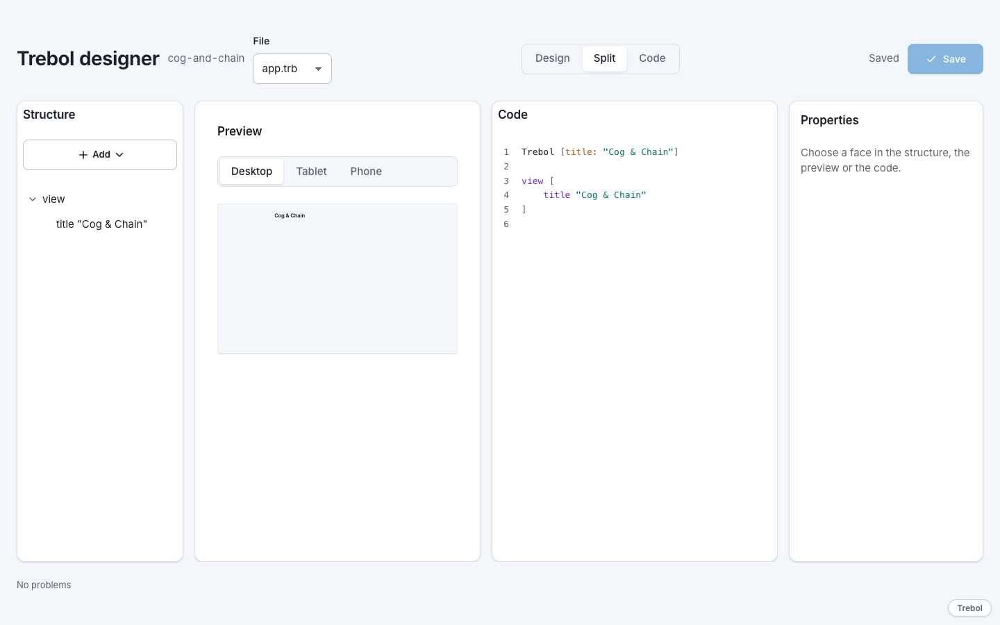

# 1. The window

The second tutorial wrote the screens of **Cog & Chain**, the bicycle repair shop, by hand. This one builds them
again with the mouse, in **the designer**: you add faces from a menu, choose them, set what they say and what
they do, and see the screen as it will look while you work. Everything you do is written into `app.trb` as
Trebol, the way a person would write it, so you can go on by hand at any moment, and the designer follows.

The designer is a program of its own, `trebol-dev`, run with `npx` like Trebol: it needs nothing but the
`cog-and-chain` folder of the first tutorial.

## Opening the designer

In the `cog-and-chain` folder, start an `app.trb` with only a title:

```trebol-ui
Trebol [title: "Cog & Chain"]

view [
    title "Cog & Chain"
]
```

and run the designer on the folder:

```sh
npx trebol-dev
```

It opens on <http://localhost:5180/>: open that address in a browser. `npx trebol-dev other-folder` designs
another folder, and `--port 5190` picks another port. Only your own computer reaches it. It runs until you
press Ctrl+C in the terminal.

## The parts of the window



**At the top**

- The name of the folder, and **File**: every `.trb` file of the project, outside `node_modules` and hidden
  folders. Choose one to design it.
- **Design / Split / Code**: what the middle shows. *Design* gives it all to the preview, *Code* all to the code,
  *Split* shows both side by side.
- **Saved** or **Changed**, and **Save**. *Changed* says the file has changes not written to disk yet.

**Structure**, on the left: the faces of each `view` in the file, nested as they are written. A face that holds
others, a form, a panel, a screen, opens and closes with the arrow beside it. **Add**, above it, adds a face.

**Preview**, in the middle: the screen as it will look. The buttons above it show it as wide as a desktop
(1280 × 800), a tablet (834 × 1112) or a phone (390 × 844). The preview lays the screen out without running the
program, so a table, a list, a board or a chart shows a few made-up rows of the columns it has. When a face has a
problem, a table under the preview says which and where.

**Code**, in the middle: the file itself, coloured as Trebol, with a bar beside the lines of the chosen face.

**Properties**, on the right: everything about the chosen face.

At the bottom left, how many problems the file has.

## The chosen face

Almost everything in the designer works on **the chosen face**. There are three ways to choose one, and they
are the same:

- click its row in the **Structure**;
- click it in the **Preview**;
- put the cursor in it in the **Code**.

A face chosen in one is chosen in all three: its row is marked in the structure, it is outlined in the preview,
and its lines are marked in the code.

Each part of the window scrolls by itself; the window itself never does.

## What's next

The [next page](02-first-screen) gives the counter of the shop its form, with the mouse.
