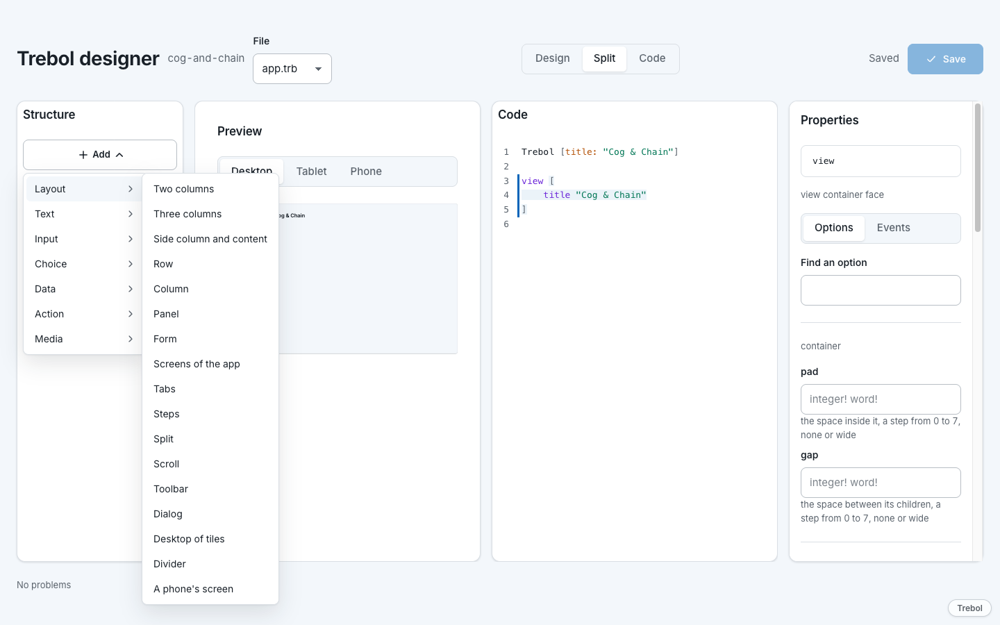
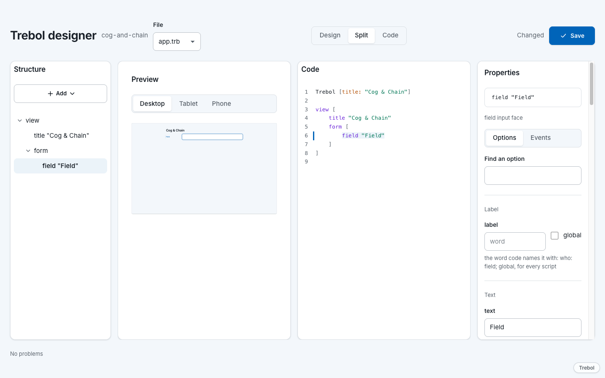
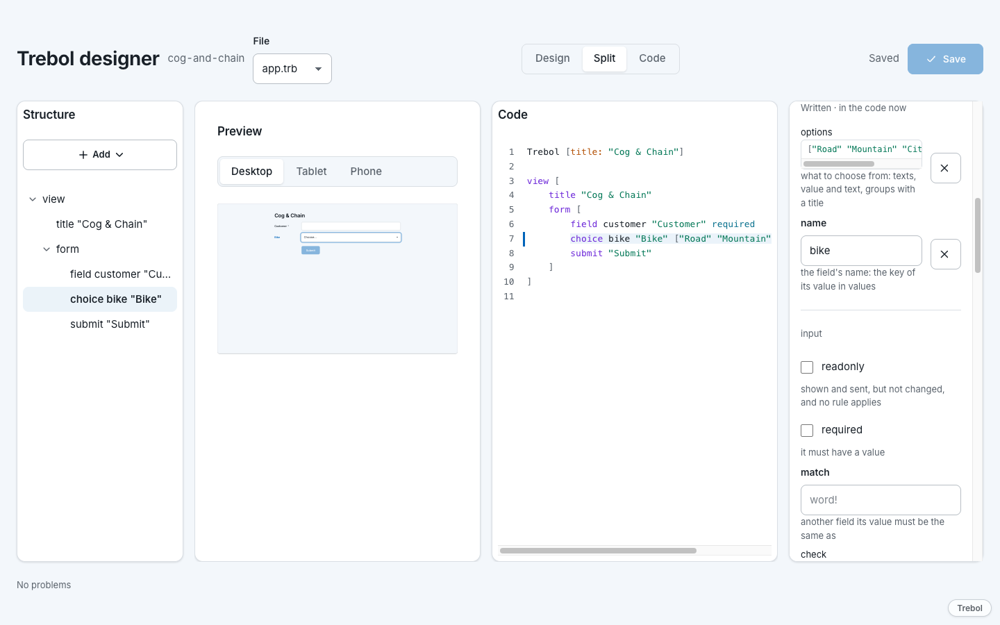
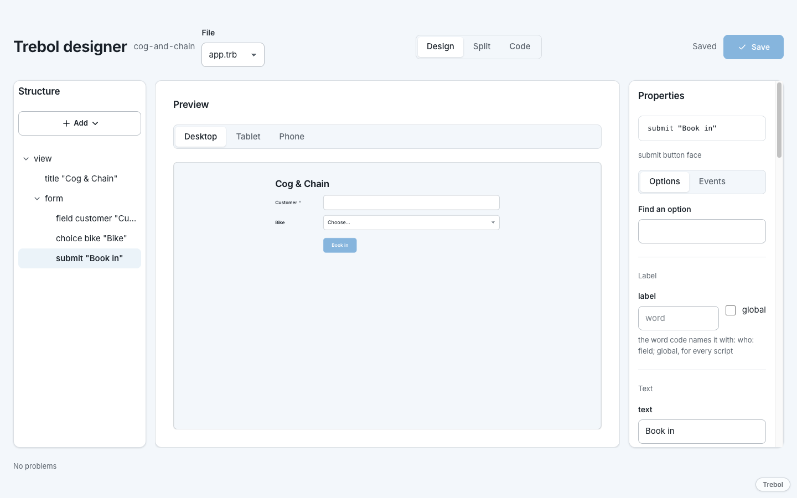
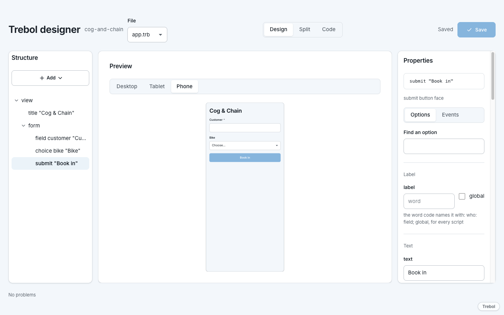

# 2. A first screen

A bike comes in through the door and the shop writes down whose it is and what kind of bike. This page builds
that form with the mouse, from the title of the last page.

## Adding a face

**Add** puts the new face in a place that depends on the chosen face:

- when the chosen face holds others (a view, a form, a panel, a row, a column, a grid, a screen, a tab...), the
  new face goes **inside it, last**;
- otherwise it goes **right after the chosen face**, beside it;
- with nothing chosen, it goes last in the file's first view.

The face added is then the chosen one, so what you do next is about it.

1. Click **view** in the structure.
2. Click **Add**. Its menu has a group for each kind of face: *Layout*, *Text*, *Input*, *Choice*, *Data*,
   *Action* and *Media*. Point at **Layout**:

   

3. Click **Form**. A `form` comes into the structure, inside the view and after the title, and it is chosen.
4. With the form chosen, click **Add**, **Input**, **Field**. The field goes inside the form.



The code has followed:

```text
view [
    title "Cog & Chain"
    form [
        field "Field"
    ]
]
```

indented as the rest of the file. Whatever you do with the mouse changes the code this way, and only where it
has to.

## The customer

With the field chosen, find **text** in the properties and type `Customer`: it is the field's label. Then find
the option **name**, among those of `input`, and type `customer`: it is the key of the field's value when the
form gives its values. A bike is never booked in for nobody, so tick **required**, a few options further down.
The code reads `field customer "Customer" required`, and the preview marks the label with a star.

## The bike

The field holds no faces, so a face added now goes after it, still in the form.

1. **Add**, **Choice**, **Choice**. A `choice` comes in with two made-up options.
2. Type `Bike` in **text** and `bike` in **name**.
3. Its options are a block, so the properties show it in a small code box, **options**. Write the kinds of
   bike in it: `["Road" "Mountain" "City" "Child's"]`.



## The button

**Add**, **Action**, **Submit**: the button that sends the form. Type `Book in` in its **text**. The counter
now reads:

```trebol-ui
Trebol [title: "Cog & Chain"]

view [
    title "Cog & Chain"
    form [
        field customer "Customer" required
        choice bike "Bike" ["Road" "Mountain" "City" "Child's"]
        submit "Book in"
    ]
]
```

## Moving and deleting

- **Drag** a row of the structure up or down among the faces beside it to move its face. **Up** and **Down**,
  at the bottom of the properties, move it one place at a time.
- **Delete** takes the chosen face out, with every face inside it.

A face moves among the faces of the box it is in. To put it into another box, move its lines in the code: the
structure follows at once. The view is never moved nor deleted, as it holds the rest.

A face that moves takes its comment with it, and one that goes takes its line.

## On a phone

Choose **Design** at the top, so the preview has the whole middle:



and **Phone** above the preview. The form lays itself out again for the narrow screen, each label over its
field and the button as wide as the screen:



Back in **Split** and **Desktop**, click **Save**: the file is written and *Changed* turns to *Saved*. Choosing
another file while this one has changes asks first whether to leave them.

## What's next

The [next page](03-properties) goes through the properties: the rules a field keeps, the word code knows a face
by, and how to find an option among many.
