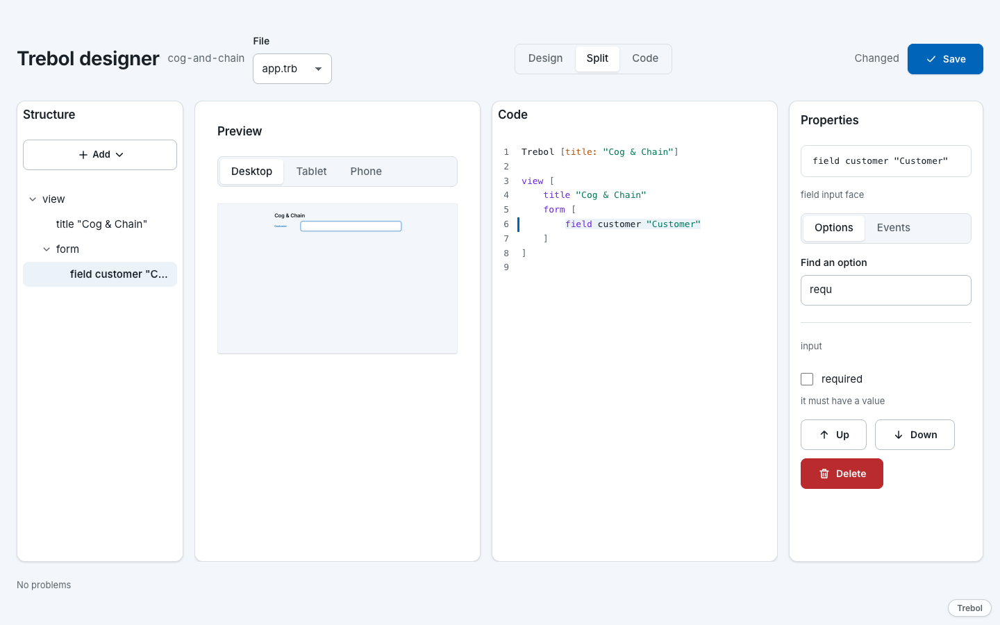
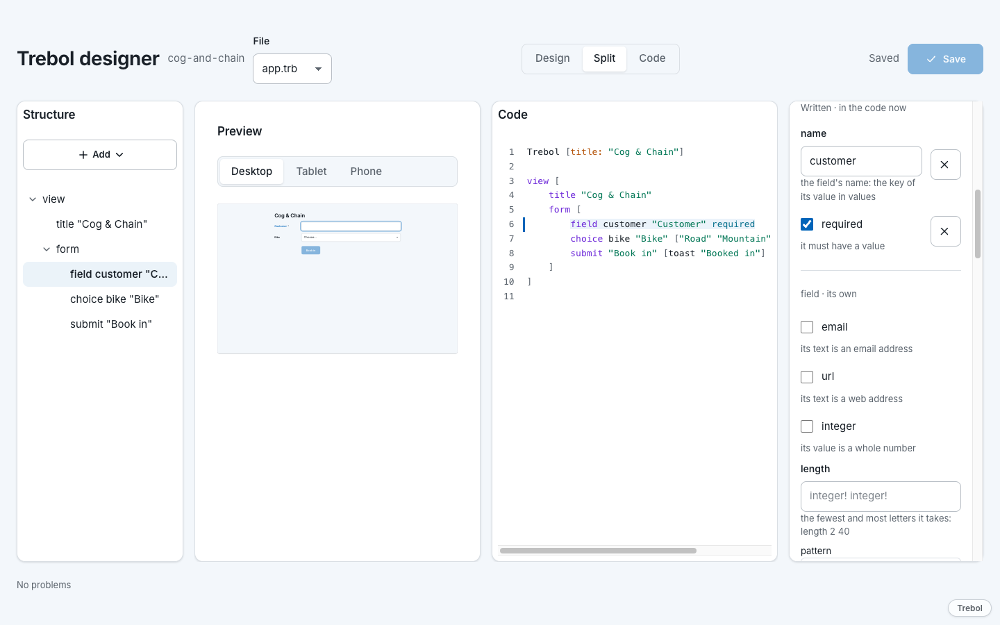

# 3. Properties

The properties show everything about the chosen face, and each change made there is a change in the code.

## The top of the panel

- The face as the structure names it, in a box: `field customer "Customer"`.
- Under it, its **style** and the styles it is made from: `field input face` says it is a `field`, made from
  `input`, made from `face`. It takes the options of all three.
- **Options / Events**: what the panel shows. This page is about *Options*; [events](04-events) are next.
- **Find an option**: type part of an option's name or of its help, and only those that match stay.

A face has many options, so finding one is quicker than looking for it. Choose the customer field and type
`requ`:

Empty the box to see them all again.

## Written in the code now

The options the face has are listed first, under **Written · in the code now**, each with a **×** that takes it
out of the code. It is where to look to see at a glance how a face differs from a plain one:

## Label

**label** is the word code reaches the face by, as in the second tutorial. With `who` in it the code reads
`who: field customer "Customer" required`, and any action of the view can read what was typed with
`who/value`, or set it with `who/value: "Ann"`.

Tick **global** to make the word known to every script of the program, not only to this view:
`global who: field customer "Customer" required`. Empty the label to take it out.

The label is not the **name**. The name is the key of the field's value in `values`, when the form gives them
all together (`values/customer`); the label is a word for the face itself. A field may have both.

## Text

- **text** is what the face says: the words of a title, the label of a field, the caption of a button.
- **hint** is the grey text a field shows while it is empty.

## Options

Under them come the options its style takes, in a section for each style it is made from: first its own
(`field · its own`), then those of `input`, then those of every face. Each option has a line of help under it,
and a control that fits what it takes:

- **a box to tick**, for an option that is on or off: `required`, `email`, `hidden`;
- **joined buttons**, or **a list** when they are many, for one word among a few: a size, an alignment;
- **a field**, for values: a number, a text, a pair. Its grey hint says what it takes (`integer! integer!` is two
  whole numbers). When what is typed is not what the option takes, it says so under the field, and the code is
  left as it was until it is;
- **a small code box**, for an option that takes a block, as the options of a choice;
- **a field and a *Pick* button**, for an icon: type its name, `#star`, or pick one of the icons Trebol brings.

Some options are written in more than one way. The columns of a grid take a number of equal columns, `3`, or a
weight for each, `[1 2 1]`, or `[small 1]` for a narrow column at the side: type any of them.

## Follows other faces

At the end, three small code boxes make the face follow others, as on the forms page of the second tutorial:

- **is**: its value is what the block gives, worked out again each time a value the block reads changes;
- **calc**: the same, for a value nobody types in, as a total: `calc [values/qty * values/price]`;
- **react**: a block that runs again each time a value it reads changes.

## The view

Choosing **view** in the structure shows the words of the whole screen: how wide it is, the space inside it and
between its faces. A view has no label and no text.

## What's next

The form does not do anything yet. The [next page](04-events) gives the button its action.
