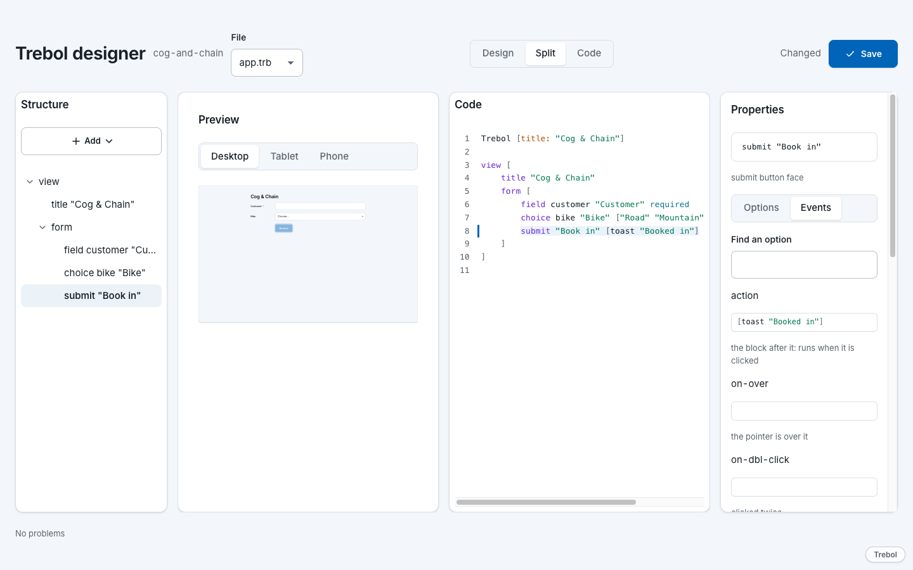

# 4. Events

Choose **Events** at the top of the properties to see what the chosen face can answer to, each with a small code
box for the Trebol that runs then.

## The action of the button

Choose **submit "Book in"** and **Events**. The first box, **action**, is the block written right after the face,
run when it is clicked. Type in it:

```text
[toast "Booked in"]
```



The code becomes `submit "Book in" [toast "Booked in"]`, and the counter is the one of the second tutorial's
first pages:

```trebol-ui
Trebol [title: "Cog & Chain"]

view [
    title "Cog & Chain"
    form [
        field customer "Customer" required
        choice bike "Bike" ["Road" "Mountain" "City" "Child's"]
        submit "Book in" [toast "Booked in"]
    ]
]
```

The preview does not run the program: it shows how the screen looks, not what it does. To press the button, run
the app itself, with `npx trebol dev` in the folder, as in the second tutorial.

## The other events

After the action come the events the face's style fires, each with a line that says when: `on-change` (*its
value changed*), `on-focus` (*it took the focus*), `on-key` (*a key was pressed while it has the focus*),
`on-over` (*the pointer is over it*), and so on. A face lists only the events of its own style: a field has
`on-change`, a button has not.

Type a block in one, `[toast "Changed"]` in the `on-change` of the customer field, and the code gets
`on-change [toast "Changed"]` after the face. The events a face answers to already come first, each with a
**×** that takes it out; emptying its box does the same.

What a block has at hand depends on the event: in `on-change` the new value is `value`, in the `on-select` of a
table the row chosen is `row`. The [reference](../reference/index) says what each event gives.

**Find an option** narrows the events too: `sel` leaves `on-select`.

## The view's events, and a screen's

The view's events are those of the whole window: `on-key` gets the keys no face takes, `on-find` what is asked
in the palette (Ctrl+K). A screen of an app, on the [next page](05-screens-tabs-rows), adds `on-enter` and
`on-leave`, run when the app goes to it and leaves it.

A tab or a step has no events of its own: its faces have them.

## What's next

One screen is not a shop. The [next page](05-screens-tabs-rows) gives Cog & Chain its screens.
