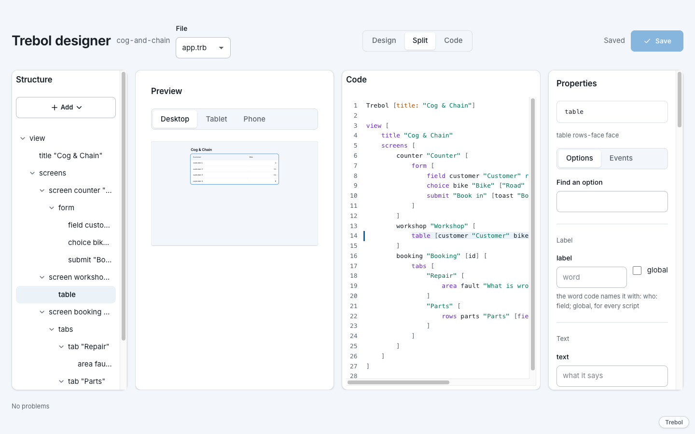
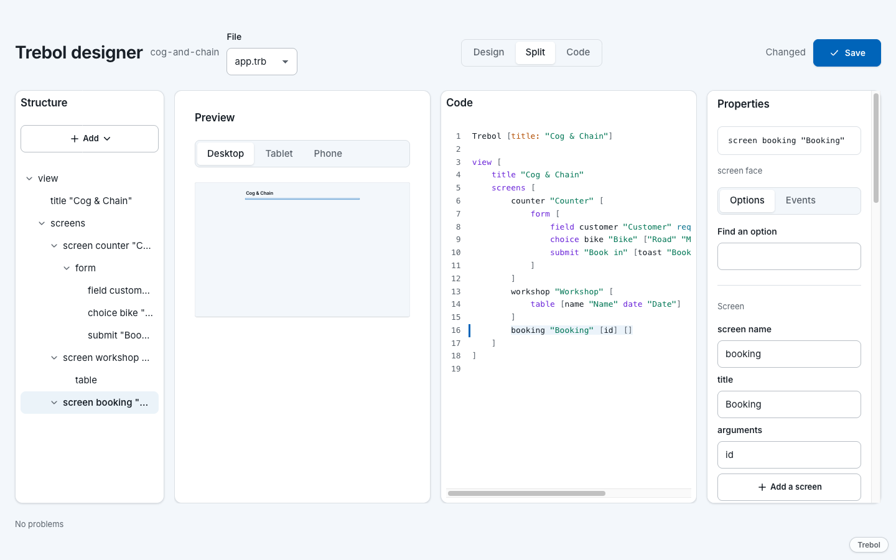
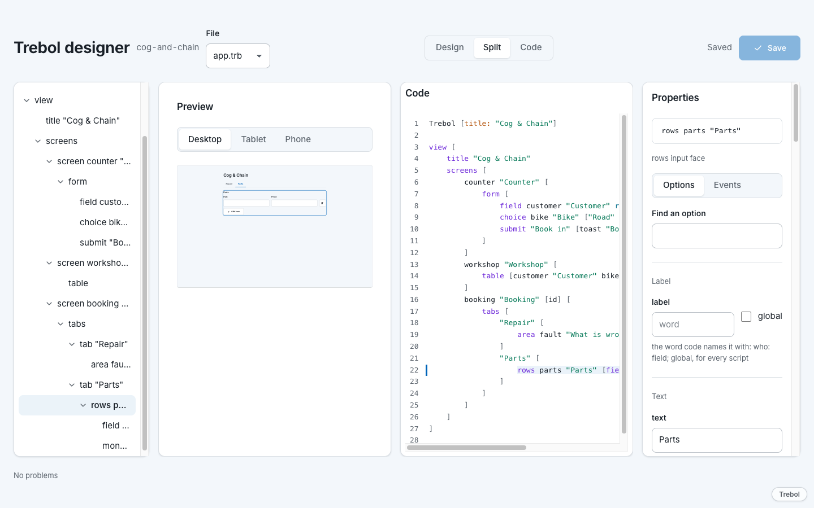

# 5. Screens, tabs and rows

The shop needs more than the counter: the bikes in the workshop, and a page for each booking. This page gives
`app.trb` its screens, a booking its tabs, and the parts of a repair their rows.

## The screens of the app

1. Choose **view** and click **Add**, **Layout**, **Screens of the app**. The designer adds `screens`, after the
   form, with two screens to start with, *Home* and *Details*.
2. Each screen is a row of the structure, with its faces under it. Choose `screen home "Home"`. Its properties
   have a section **Screen**:
   - **screen name**: the word the app goes to it by, `go 'counter`. Type `counter`.
   - **title**: what the window is called while it shows. Type `Counter`.
   - **arguments**: what the screen is given when the app goes to it. None here.
   - **Add a screen** adds another, empty, after the last.
3. Choose `screen details "Details"`: name it `workshop`, titled `Workshop`.

The counter's form belongs in the counter screen. A face moves with the mouse only among the faces beside it, so
put it there in the code: cut the lines of the form, from `form [` to its `]`, and paste them into the counter's
block, in place of its `text "Home"`. The structure follows as soon as the code loads again.

## The workshop

Choose `text "Details"` and **Delete** it. Choose the workshop screen and add **Data**, **Table**. A table shows
the fields of its rows in columns, in the small code box **columns**: write the ones of a booking,
`[customer "Customer" bike "Bike"]`. The preview fills it with a few made-up rows, so you see how it looks:



## A screen for each booking

Choose the workshop screen and click **Add a screen**. Choose the new one and name it `booking`, titled `Booking`,
with `id` in **arguments**: the app goes to it with `go [booking 42]`, and its code reads `id`.



The preview shows one screen at a time: the one the chosen face is on, or the first when the chosen face is on
none. The first screen is the one the app starts on, so screens are not moved with *Up* and *Down*; *Delete*
takes one out with its faces.

## Tabs

A booking shows the repair on one tab and its parts on another.

1. Choose the booking screen and add **Layout**, **Tabs**. Two tabs come in, *One* and *Two*, each a row of the
   structure.
2. Choose `tab "One"`. A tab has one property, its **label**: type `Repair`. Choose `tab "Two"` and type
   `Parts`. **Add a tab** would add a third.
3. Choose `tab "Repair"` and add **Input**, **Long text**: `What is wrong` in its **text**, `fault` in its
   **name**.

Choosing a face in a tab shows that tab in the preview, so the face is always in sight. A tab has no options and
no events of its own; *Delete* takes it out with its faces. **Steps**, a wizard with *Back* and *Next*, work the
same way, with **Add a step**.

## Rows

The parts of a repair are a list the shop fills in, one part per row: `rows`. You design one row, and the user
adds as many as the repair needs.

1. Choose `tab "Parts"` and add **Input**, **Rows**: `Parts` in its **text**, `parts` in its **name**.
2. Under it in the structure is the row it repeats, with one field. Choose the field: `Part` in **text**, `part`
   in **name**.
3. Choose the `rows` again and add **Input**, **Money**: it goes into the row, beside the part. `Price` in
   **text**, `price` in **name**.



The app now reads:

```trebol-ui
Trebol [title: "Cog & Chain"]

view [
    title "Cog & Chain"
    screens [
        counter "Counter" [
            form [
                field customer "Customer" required
                choice bike "Bike" ["Road" "Mountain" "City" "Child's"]
                submit "Book in" [toast "Booked in"]
            ]
        ]
        workshop "Workshop" [
            table [customer "Customer" bike "Bike"]
        ]
        booking "Booking" [id] [
            tabs [
                "Repair" [
                    area fault "What is wrong"
                ]
                "Parts" [
                    rows parts "Parts" [field part "Part"  money price "Price"]
                ]
            ]
        ]
    ]
]
```

The row of `rows` was written on one line, `[field "Item"]`, so the price went beside the part on that line, as
you would have written it.

## What's next

The [next page](06-styles-of-your-own) brings the styles a file defines into the *Add* menu.
