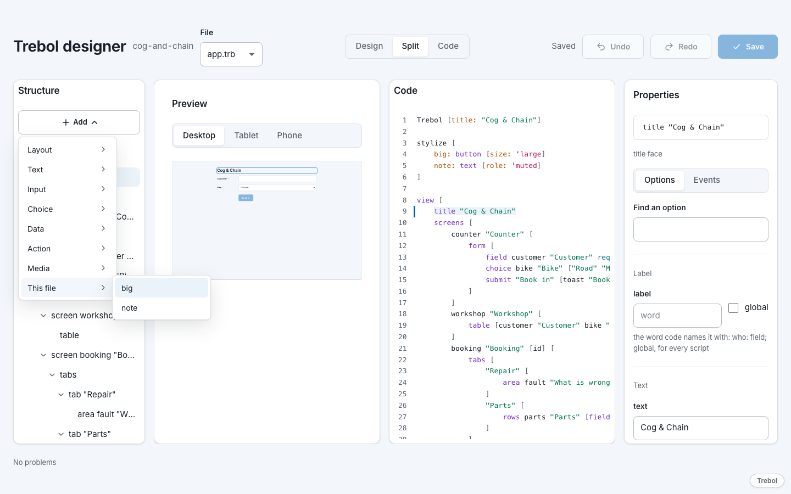

# 6. Styles of your own

The last page of the second tutorial made styles of the shop's own with `stylize`: a muted note, a big button.
The designer reads the styles a file defines and offers them in the *Add* menu, beside Trebol's.

## The styles in the file

Write them in the code, between the header and the view:

```text
stylize [
    big: button [size: 'large]
    note: text [role: 'muted]
]
```

The code colours `big` and `note` as it colours Trebol's own styles, and the designer knows them as it knows
those.

## Adding one

Choose the title of the view and click **Add**. At the end of the menu is a new group, **This file**, with every
style the file defines:



Click **note**. It goes after the title, chosen: type `Bicycle repairs, done right.` in its **text**. Its
properties are those of the style it is made from: the panel says `note text face`, and its options come in a
section for each.

```trebol-ui
Trebol [title: "Cog & Chain"]

stylize [
    big: button [size: 'large]
    note: text [role: 'muted]
]

view [
    title "Cog & Chain"
    note "Bicycle repairs, done right."
]
```

A style made from one that holds faces, a `panel`, a `row`, a `column`, comes in with an empty block, ready for
the faces you put in it. One made of its own faces, with a `layout:`, comes in with a block only when that layout
says `slot`, where the faces you put in it go; without `slot` it holds just its own.

## Styles from other files

Styles worth keeping go in a file of their own, so every screen of the shop uses the same ones. Move the
`stylize` block to `styles.trb`, next to the screen, and import it:

```text
Trebol [title: "Cog & Chain"]

import %styles.trb

view [
    title "Cog & Chain"
    note "Bicycle repairs, done right."
]
```

The designer reads what the file imports, and what those files import in turn, as `trebol check` does: their
styles and rules, nothing else. A package works too: `import 'shop-kit` reads the file its `package.json` names
under `"trebol"`. The *Add* menu then has one more group, **Imported**, with the styles that come from them; the
file's own stay in **This file**.

A style from another file is used like any other, but it is changed in its own file: open `styles.trb` from the
**File** list. When you go back to the screen, the designer reads it again.

## Rules of the file

A file may add words of its own to the dialect with `rule`, as the forms page of the second tutorial does with
`frame-number`. The designer runs the file's rules as it runs its styles, so the faces that use them look as they will,
and the options of a face list them with a box to tick each on or off.

## What's next

The [last page](07-the-code) is about working in the code beside the design: what the designer keeps, the
problems it points out, and saving.
