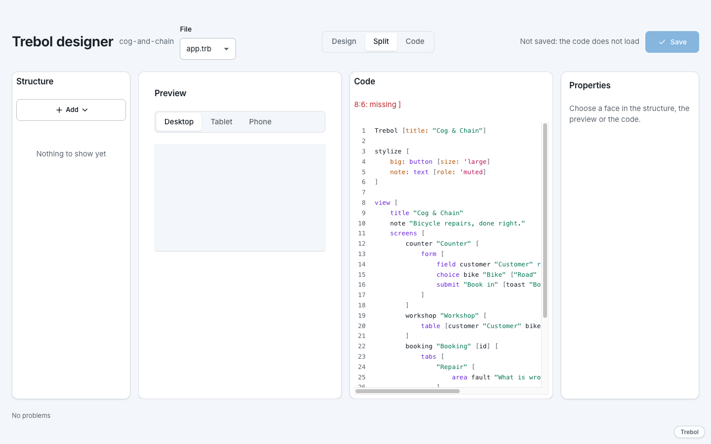
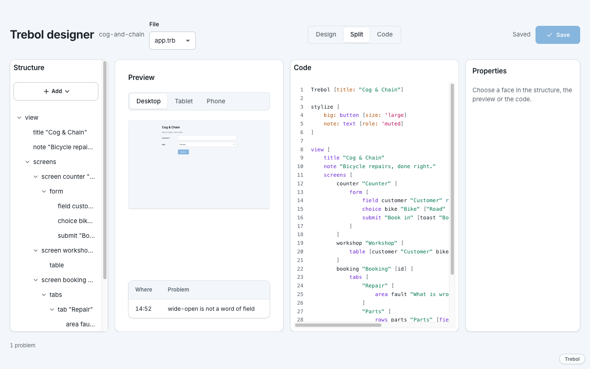

# 7. The code

The designer keeps no design of its own: the text of the file is the design. What you do in the structure or the
properties rewrites the text, and what you write in the text changes the structure and the preview. Go from one
to the other whenever you like.

## What it changes and what it keeps

A change rewrites only the text it is about. A new label replaces the old string and nothing else; a face added
gets a line of its own, indented as the faces beside it, or goes beside the last face of a block written on one
line; a face that moves takes its comment with it; a face that goes takes its line. Your comments, blank lines,
spacing and order stay as you wrote them, and nothing outside the views is touched.

## Writing by hand

Choose **Split** to see the code beside the preview, or **Code** to give it the whole middle. Type as in any
editor: the structure, the preview and the properties follow as you type.

Putting the cursor in a face chooses it: the innermost face written around the cursor. With the cursor in a field
of a form, the field is chosen, not the form.

Some things are written by hand only. A value worked out when the program runs, as a text made with `compose`
and parentheses, is kept as written, but no property changes it: change it in the code.

## Problems

Two kinds of problem show.

**The code does not load.** A bracket or a quote is missing, and the text is not Trebol yet. The top of the window
says *Not saved: the code does not load*, the code says where and why in red (`8:6: missing ]`: the block that
opens on line 8, at column 6, is not closed), and *Save* waits until it loads again. While you type, the
structure and the preview keep the last design that loaded, so nothing jumps around; a file opened that does not
load shows none until it does.

**A face has a problem.** The code loads, but something in a view is wrong: a word a style does not take, an
icon Trebol does not have, a block where a text goes. A table under the preview gives each problem the line and
column it is at, and the bottom of the window counts them. They are the problems `trebol check` finds, as the page
[when it goes wrong](../ui/12-when-it-goes-wrong) of the second tutorial tells; the file can be saved with them.

## Saving

**Save** writes the file. *Changed* says there is something not saved. Choosing another file in **File** while
this one has changes asks whether to leave them; saying no stays on the file.

The designer has no *Undo* of its own yet: a change made with the mouse is taken back by changing it back, and
leaving a file without keeping its changes takes back all of them. Save often, and keep the project in git.

## On a web page

The designer also runs on a page with no project behind it, as on [trebol-lang.com](https://trebol-lang.com/designer/).
It then opens a sample project, and *Save* downloads the file.
