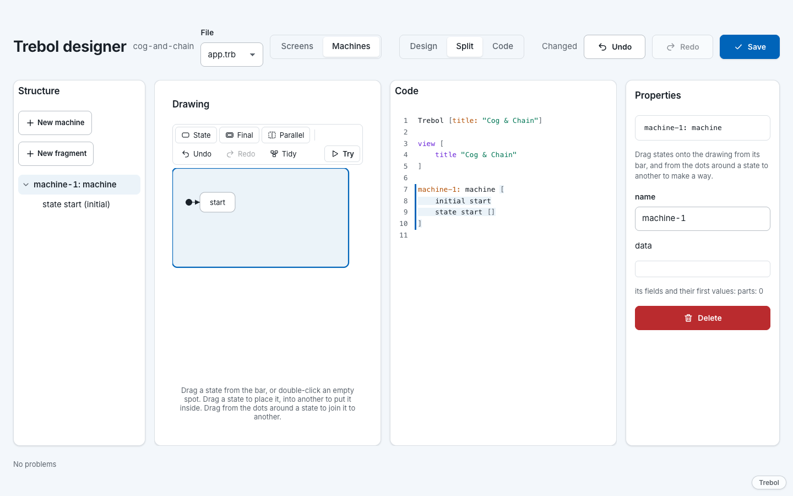
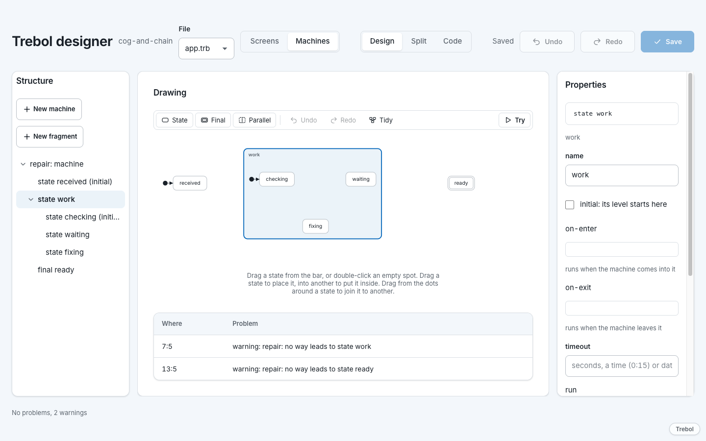
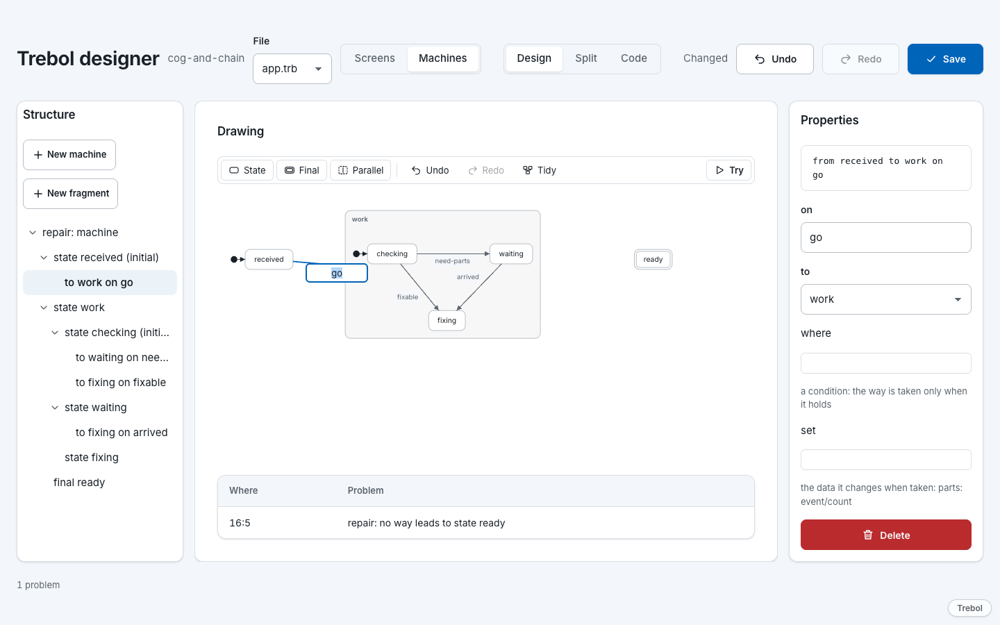
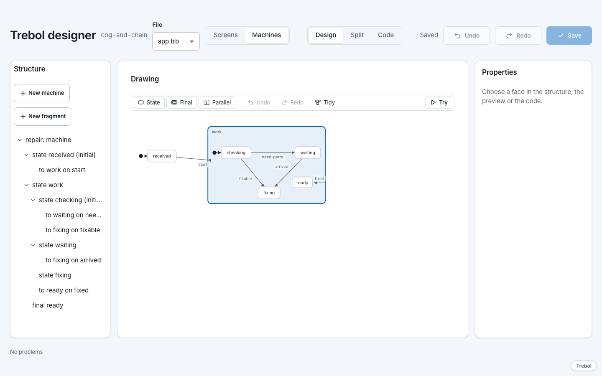
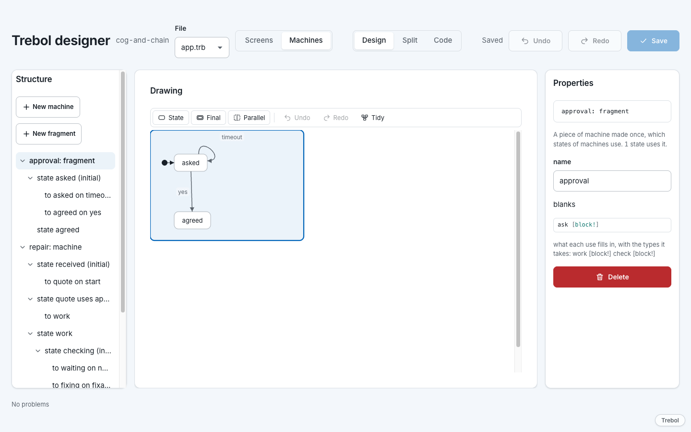
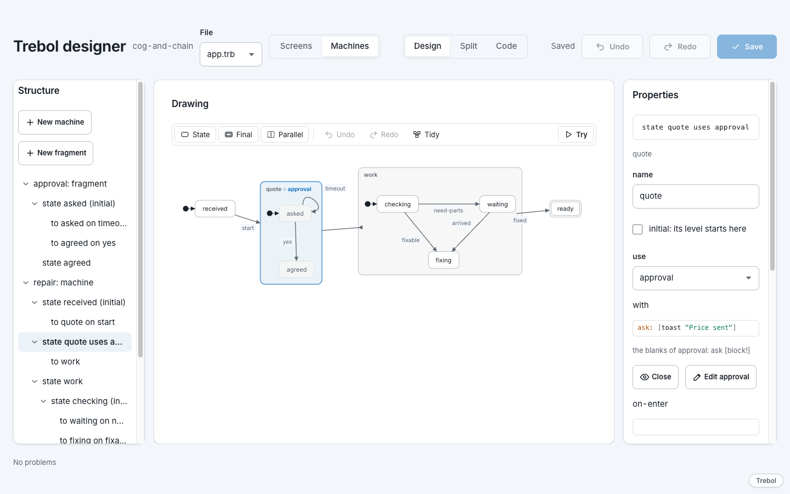
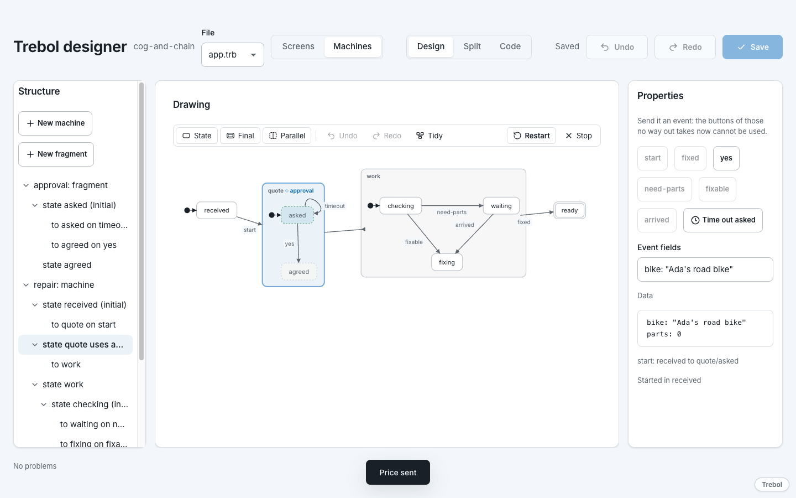

# 8. Machines with the mouse

The first tutorial gave Cog & Chain a **machine** for its repairs (see [Machines](../language/15-machines)): a bike
is received, then worked on (checked, perhaps waiting for parts, fixed), then ready. The designer makes machines
as it makes screens: you add states from a menu, draw the ways between them with the mouse, and set what each
does in its properties. It writes the machine into `app.trb` as you would. Then you can **try** it, sending it
events with buttons and watching where it goes, before any screen uses it.

## The machines of a file

**Machines**, at the top, switches the window from the **Screens** of the file to its machines. The structure
lists every machine the file makes, with the states inside each one and the ways out of each state. The centre
shows the chosen machine as a **drawing**, with a bar over it. A file that makes none says so:


**New machine** writes a new machine at the end of the file. It has one state, its initial one, as every machine
needs. Choose the machine and type its name, `repair`, in **name**: the code now says `repair: machine [...]`,
and the rest of the program calls it by that word.



## States

**State**, **Final** and **Parallel**, on the bar, are dragged onto the drawing: the new state goes where it is let
go, and its name is typed in place, on its box. Let go inside another state, it goes into that one, which then
holds states of its own. A double click on an empty spot adds a state there too, and a double click on a name
renames it. The first state of a level is its initial state; a right click on another one gives *Make it the
initial state*, with *Add a state inside*, *Rename* and *Delete the state*.

Rename `start` to `received`. Add a state `work`, and drop `checking`, `waiting` and `fixing` inside it. Then add a
**Final** state `ready` beside `work`, where a repair ends.

In the drawing a state is a rounded box. A state with states inside is a box around them, with its name on top. A
final state has a double border, and a black dot points at the initial state of each level.



Below the drawing the machine already has a warning: no way leads to `work`. A warning is not a mistake: the
machine is made and runs, and the state is only waiting for the way to it. The designer asks the machine itself
what is wrong, as `trebol check` does, and shows the first mistake it finds, or its warnings, with the line and
column. The count at the bottom of the window adds these to those of the screens, warnings apart. Each one goes
away when it is put right.

## Ways

A **way** takes the machine from one state to another when an event comes. Point at a state in the drawing: four
dots show around it. Drag one of them onto another state and let go. The designer writes `from received to work
on go`, chooses the new way and lets you type its event in place, over `go`:



Type `start` and press Enter. A dot dragged to an empty spot makes a new state there, and the way to it. In the
same way draw `checking` to `waiting` on `need-parts`, `checking` to `fixing` on `fixable`, `waiting` to `fixing`
on `arrived`, and `work` to `ready` on `fixed`. In the way's properties, **on** says which events take it: with
`[start resume]`, either one does. **to** sends it to another state. A way can also start from the properties:
**Add a way**, in a state's properties, lists every state it can go to.

A way's properties have two boxes of code:

- **where**, a condition: the way is taken only when it holds, as `[data/parts > 0]`;
- **set**, the data it changes when it is taken.


The machine's own data, the fields and their first values, is in the machine's properties under **data**:
`bike: none  parts: 0`. Then `set [parts: event/count]` on `need-parts` keeps the number of parts the event
brings, and `set [bike: event/bike]` on `start` keeps the bike. A state's properties hold the rest of what a state
can do: **on-enter** and **on-exit** code, a **timeout**, work to **run**, events to **defer**, and for a state
with states inside, whether it comes back to the one it left (**history**). Everything is written into the code,
which marks the state or way chosen. Putting the cursor in the code chooses the state or way written around it.

The machine now reads:

```trebol
repair: machine [
    data [bike: none  parts: 0]
    initial received
    state received []
    state work [
        initial checking
        state checking []
        state waiting []
        state fixing []
        from checking to waiting on need-parts set [parts: event/count]
        from checking to fixing on fixable
        from waiting to fixing on arrived
    ]
    final ready
    from received to work on start set [bike: event/bike]
    from work to ready on fixed
]
```

## Where states go

Each state stays where you put it: drag a state to any spot and let go. Drop it **inside** another state and it
goes into that one, which grows to hold it; drag it out of its box and it leaves it, its ways going with it. While
a state is carried, the box it would go into is lit:



A state with states inside takes them along. A new state goes where you drop it from the bar, where you
double-click, or where you let go of a way dragged to an empty spot. The arrow keys move the chosen state, a
little at a time, and more with Shift; *Take it out of*, in its right-click menu, moves it out of the state it is
in. **Undo** and **Redo**, on the bar, undo a move as they undo any other change.

The designer keeps these places in the file, after everything else, in a comment, so the machine never sees
them:

```
; layout [
;     repair [
;         received 40x110  work 220x40  work/checking 40x60  work/waiting 260x60  work/fixing 150x180  ready 740x110
;     ]
; ]
```

Each state is named by its path in the machine, and its place is the top-left corner of its box, counted from
the box it is in. Rename a state, move it or delete it, and its place follows. A state with no place, as one you
write yourself in the code, goes to the right of the others. A machine with no places at all, as one written
by hand, is laid out by the designer the first time it is drawn. **Tidy**, on the bar, lays the whole machine
out again.

## Trying it

**Try**, at the end of the bar, makes the machine and starts it, here in the designer. While it runs, the properties
give their place to it:

- a button for each event its ways name. Those no way out takes now cannot be used: at the start only `start`
  can.
- **Event fields**: the fields the next event carries, as in a block: `bike: "Ada's road bike"  count: 3`.
- its **data** as it is now;
- what happened, the newest first.

In the drawing, the states it is in are lit. Type the fields, press **start**, then **need-parts**: the machine
goes into `work`, then to `waiting`, and the data keeps the bike and the three parts.


The machine's timers run as they would in the app. A state with a `timeout` also gets a button, *Time out*, which
makes the time go off now, so a quarter of an hour need not pass to see what follows. A machine that reaches a
final state says it ended. **Restart**, on the bar, starts it again from its initial state, and **Stop** ends the trial.
Typing in the code stops it too, since the machine it ran is no longer the one written: a note says so, and
*Try* makes it again.

What the machine does while it is tried, its `on-enter` code or work it runs, really runs, in the designer's page.
A shared machine (`shared`) is tried alone, without the app's other tabs, and its `on-save` is left out, so trying
it saves nothing.

## Pieces used again

Before any work, the shop sends the customer the price and waits for a yes, sending it again if a day goes by
with no answer. The shop will ask the same way when a repair needs more parts than planned. A shape that comes
back is made once as a **fragment** (see [Pieces used again](../language/15-machines)): a piece of machine with
blanks, which a state **uses** with the blanks filled in.

**New fragment**, in the structure, writes one before the file's machines, since a machine can only use a
fragment made before it. A fragment is listed with the machines and made on its own drawing, in the same way. Name it `approval`, and draw a state `asked` with a way to itself on
`timeout`, and a state `agreed` it goes to on `yes`. In **blanks** write `ask [block!]`: each use gives code to
`ask`, which says how the customer is asked. Give `asked` the `on-enter` code `ask` and the `timeout` `24:00`.
`agreed` has no way out: when the machine gets there the fragment has done its work.



Back in `repair`, add a state `quote` between `received` and `work`: the way from `received` goes to `quote` now
on `start`, and a way with no event goes from `quote` to `work`, taken when the fragment is done. In `quote`'s
properties, **use** chooses the fragment, and **with** fills its blanks: `ask: [toast "Price sent"]`. The code
says:

```trebol
approval: fragment [ask [block!]] [
    initial asked
    state asked [on-enter ask  timeout 24:00]
    state agreed []
    from asked to asked on timeout
    from asked to agreed on yes
]

repair: machine [
    data [bike: none  parts: 0]
    initial received
    state received []
    state quote [use approval with [ask: [toast "Price sent"]]]
    state work [
        initial checking
        state checking []
        state waiting []
        state fixing []
        from checking to waiting on need-parts set [parts: event/count]
        from checking to fixing on fixable
        from waiting to fixing on arrived
    ]
    final ready
    from received to quote on start set [bike: event/bike]
    from quote to work
    from work to ready on fixed
]
```

In the drawing `quote` shows the fragment's name beside its own. **Open**, in its properties or its right-click
menu, shows the fragment's states inside it, drawn dashed: they are there to be seen, and are changed on the
fragment's own drawing, which **Edit approval** or a double click on them opens. An open state is bigger, so
the states it would cover move right or down while it is open; their places in the file stay, and closing it
puts them back. Renaming the fragment renames
it wherever it is used.



When the machine is tried, the fragment's states are lit as the machine's are. After `start`, the toast says
*Price sent*, the machine is in `quote/asked`, and a *Time out asked* button sends the reminder without waiting
a day:



A blank left empty, or given something of a type it does not take, is a problem of the machine, shown under the
drawing as any other.

## Problems

A machine that the engine would not make shows why under the drawing. Here a way goes to `raedy`:


The engine finds one mistake at a time: put it right, and the next one, if any, shows. A machine with a problem is
still drawn as far as it can be; *Try* on it says, in a note, that it does not start and why.
