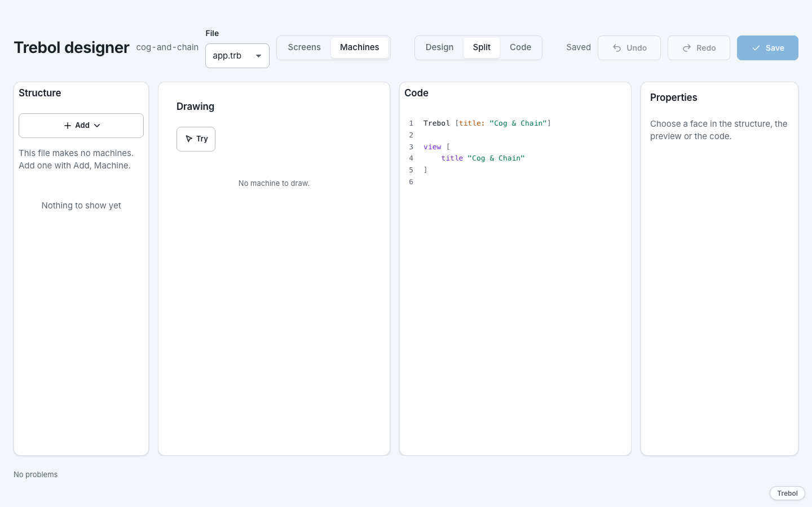
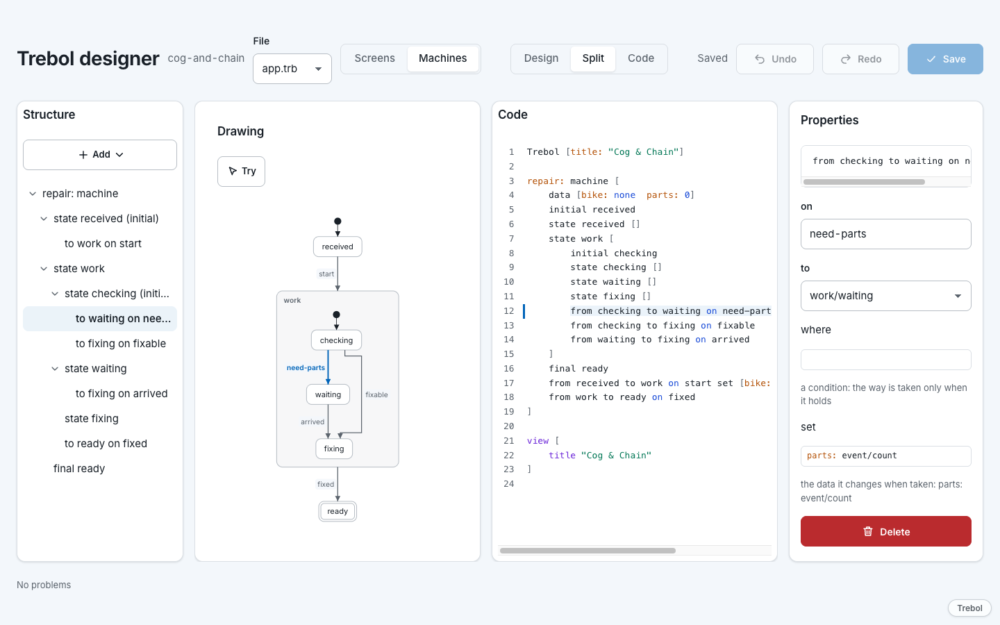
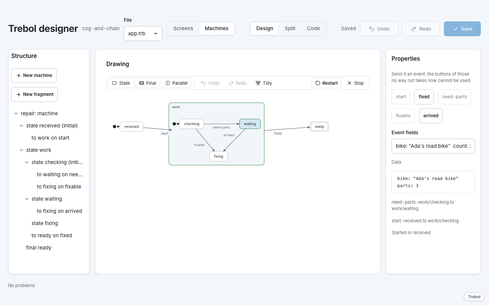
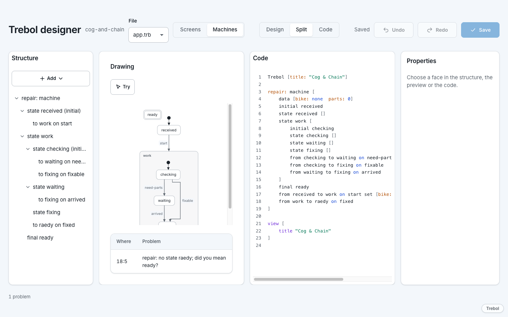

# 8. Machines with the mouse

The first tutorial gave Cog & Chain a **machine** for its repairs (see [Machines](../language/15-machines)): a bike
is received, then worked on (checked, perhaps waiting for parts, fixed), then ready. The designer makes machines
as it makes screens: you add states from a menu, draw the ways between them with the mouse, and set what each
does in its properties. It writes the machine into `app.trb` as you would. Then you can **try** it, sending it
events with buttons and watching where it goes, before any screen uses it.

## The machines of a file

**Edit**, at the top, switches the window between the **Screens** of the file and its **Machines**. In
*Machines* the structure lists every machine the file makes, with the states inside each one and the ways out of
each state. The centre shows the chosen machine as a **drawing**. A file that makes none says so:



**Add**, then **Machine**, writes a new machine at the end of the file. It has one state, its initial one, as
every machine needs. Choose the machine and type its name, `repair`, in **name**: the code now says
`repair: machine [...]`, and the rest of the program calls it by that word.


## States

**Add** puts a **State**, a **Final** state or a **Parallel** one inside what is chosen: in the machine, or in a
state, which then holds states of its own. The first state of a level is its initial state; the check box
*initial* in a state's properties moves that to another. Rename `start` to `received`. Add a state `work`, choose
it, and add `checking`, `waiting` and `fixing` inside it. Then choose the machine again and add a **Final** state
`ready`, where a repair ends.

In the drawing a state is a rounded box. A state with states inside is a box around them, with its name on top. A
final state has a double border, and a black dot points at the initial state of each level.


Below the drawing the machine already has a problem: no way leads to `work`. The designer asks the machine itself
what is wrong, as `trebol check` does, and shows the first mistake it finds, with the line and column. The count
at the bottom of the window adds these problems to those of the screens. Each problem goes away when it is put
right.

## Ways

A **way** takes the machine from one state to another when an event comes. To draw one, point at the **edge** of
a state in the drawing: the pointer becomes a cross. Drag from there onto another state and let go. The designer
writes `from received to work on go` and chooses the new way:


`go` is only a first name. In the way's properties, **on** says which events take it: type `start`. With
`[start resume]`, either one does. **to** sends it to another state. In the same way draw `checking` to `waiting`
on `need-parts`, `checking` to `fixing` on `fixable`, `waiting` to `fixing` on `arrived`, and `work` to `ready`
on `fixed`. A way can also start from the structure: **Add a way**, in a state's properties, lists every state it
can go to.

A way's properties have two boxes of code:

- **where**, a condition: the way is taken only when it holds, as `[data/parts > 0]`;
- **set**, the data it changes when it is taken.



The machine's own data, the fields and their first values, is in the machine's properties under **data**:
`bike: none  parts: 0`. Then `set [parts: event/count]` on `need-parts` keeps the number of parts the event
brings, and `set [bike: event/bike]` on `start` keeps the bike. A state's properties hold the rest of what a state
can do: **on-enter** and **on-exit** code, a **timeout**, work to **run**, events to **defer**, and for a state
with states inside, whether it comes back to the one it left (**history**). Everything is written into the code,
which marks the state or way chosen. Putting the cursor in the code chooses the state or way written around it.

The machine now reads:

```trebol
repair: machine [
    data [bike: none  parts: 0]
    initial received
    state received []
    state work [
        initial checking
        state checking []
        state waiting []
        state fixing []
        from checking to waiting on need-parts set [parts: event/count]
        from checking to fixing on fixable
        from waiting to fixing on arrived
    ]
    final ready
    from received to work on start set [bike: event/bike]
    from work to ready on fixed
]
```

## Where states go

The first time a machine is drawn, the designer lays it out by itself. From then on each state stays where you
put it: drag a state to any spot and let go. Drop it **inside** another state and it goes into that one, which
grows to hold it; drag it out of its box and it leaves it, its ways going with it. A state with states inside
takes them along. A new state goes where you drop it from the bar, where you double-click, or where you let go of
a way dragged to an empty spot. The arrow keys move the chosen state, a little at a time, and more with Shift.

The designer keeps these places in the file, after everything else, in a comment, so the machine never sees
them:

```
; layout [
;     repair [
;         received 40x30  work 40x120  work/checking 40x40  work/waiting 200x40  ready 400x30
;     ]
; ]
```

Each state is named by its path in the machine, and its place is the top-left corner of its box, counted from
the box it is in. Rename a state, move it or delete it, and its place follows. A state with no place, as one you
write yourself in the code, goes to the right of the others. **Tidy**, on the drawing's bar, lays the whole
machine out again.

## Trying it

**Try**, over the drawing, makes the machine and starts it, here in the designer. While it runs, the properties
give their place to it:

- a button for each event its ways name. Those no way out takes now cannot be used: at the start only `start`
  can.
- **Event fields**: the fields the next event carries, as in a block: `bike: "Ada's road bike"  count: 3`.
- its **data** as it is now;
- what happened, the newest first.

In the drawing, the states it is in are lit. Type the fields, press **start**, then **need-parts**: the machine
goes into `work`, then to `waiting`, and the data keeps the bike and the three parts.



The machine's timers run as they would in the app. A state with a `timeout` also gets a button, *Time out*, which
makes the time go off now, so a quarter of an hour need not pass to see what follows. A machine that reaches a
final state says it ended. **Restart** starts it again from its initial state, and **Stop** ends the trial.
Typing in the code stops it too, since the machine it ran is no longer the one written: a note says so, and
*Try* makes it again.

What the machine does while it is tried, its `on-enter` code or work it runs, really runs, in the designer's page.
A shared machine (`shared`) is tried alone, without the app's other tabs, and its `on-save` is left out, so trying
it saves nothing.

## Problems

A machine that the engine would not make shows why under the drawing. Here a way goes to `raedy`:



The engine finds one mistake at a time: put it right, and the next one, if any, shows. A machine with a problem is
still drawn as far as it can be; *Try* on it says, in a note, that it does not start and why.
