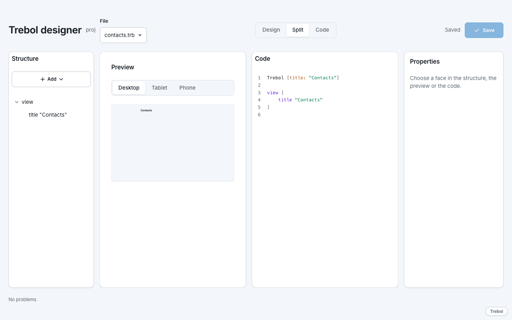

# 1. The window

## Starting the designer

Open a terminal in the folder of your project and run:

```sh
npx trebol-dev
```

or name the folder:

```sh
npx trebol-dev my-app
```

The designer opens on <http://localhost:5180/>; open that address in your browser. `--port 5190` picks another
port. Only your own computer can reach it. It keeps running until you press Ctrl+C in the terminal.

The project is any folder with `.trb` files in it. To follow this manual, make a folder with one file,
`contacts.trb`, that holds:

```trebol
Trebol [title: "Contacts"]

view [
    title "Contacts"
]
```

## The parts of the window



**At the top**

- The name of the project's folder, and **File**: every `.trb` file of the project (files in `node_modules` and
  in hidden folders are left out). Choose one to design it.
- **Design / Split / Code**: what the middle of the window shows. *Design* shows only the preview, *Code* only
  the code, *Split* both side by side.
- **Saved / Changed** and the **Save** button. *Changed* means the file has changes not written to disk yet.

**Structure**, on the left: the faces of each `view` in the file, nested as they are written. A face that holds
others (a form, a panel, a row...) opens and closes with the arrow beside it. The **Add** button above it adds a
face; see [chapter 2](02-first-screen.md).

**Preview**, in the middle: the screen as it will look. The buttons above it show it as wide as a desktop
(1280 × 800), a tablet (834 × 1112) or a phone (390 × 844). The preview lays the screen out without running
your program, so tables, lists, boards and charts show a few sample rows of the columns they have. Below it,
a table lists the problems of the screen when there are any; see [chapter 7](07-the-code.md).

**Code**, in the middle: the file itself, coloured as Trebol, with the chosen face marked by a bar beside it.

**Properties**, on the right: everything about the chosen face. Until a face is chosen it says *Choose a face in
the structure, the preview or the code*.

At the bottom left, the number of problems in the file.

## Choosing a face

Almost everything in the designer works on the **chosen face**. There are three ways to choose one, and they
all do the same:

- click its row in the **Structure**;
- click it in the **Preview**;
- put the cursor inside it in the **Code**.

The face chosen in one is chosen in all three: its row is highlighted in the structure, it is outlined in the
preview, and its lines are marked in the code.

Each part of the window scrolls by itself; the window as a whole never does.

Next: [your first screen](02-first-screen.md).
