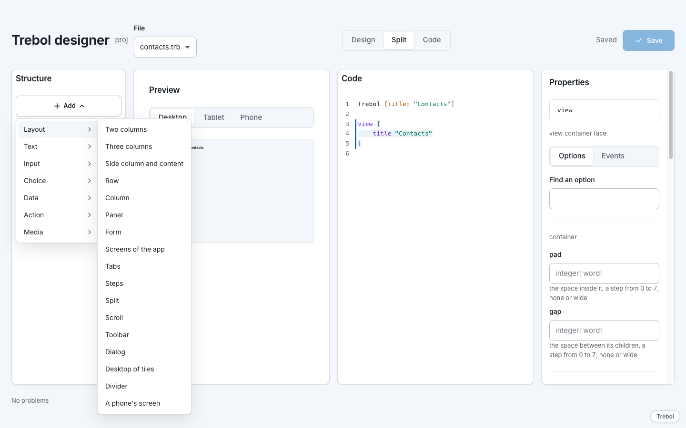
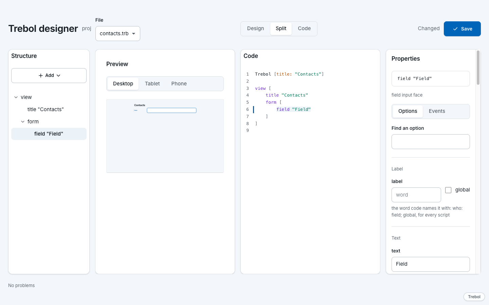
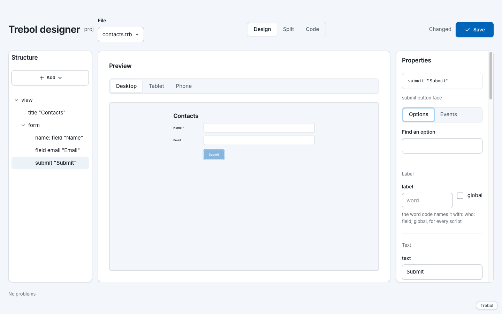
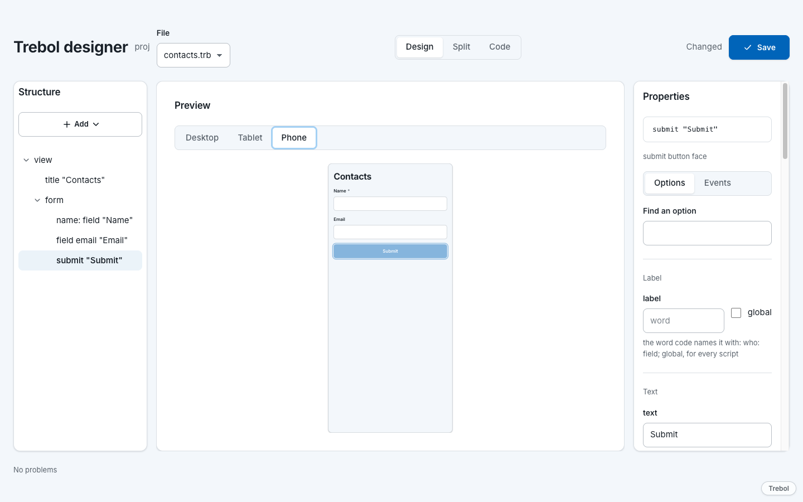

# 2. Your first screen

In this chapter you turn the `contacts.trb` of [chapter 1](01-the-window.md) into a small form: a name, an email
and a button to save them.

## Adding a face

What *Add* adds goes in a place that depends on the chosen face:

- if the chosen face holds others (a view, a form, a panel, a row, a column, a grid, a scroll, a dialog, a
  screen, a tab...), the new face goes **inside it, last**;
- otherwise, it goes **right after the chosen face**, beside it;
- with nothing chosen, it goes last in the file's first view.

The face added becomes the chosen one, so you can set its text straight away.

1. Click **view** in the structure.
2. Click **Add**. The menu has a group for each kind of face: *Layout*, *Text*, *Input*, *Choice*, *Data*,
   *Action* and *Media*. Point at **Layout**.

   

3. Click **Form**. A `form` appears in the structure, inside the view, after the title, and it is chosen.
4. With the form chosen, click **Add**, then **Input**, then **Field**. The field goes inside the form.



Look at the code: the designer wrote

```trebol
    form [
        field "Field"
    ]
```

indented as the rest of the file. Whatever you do with the mouse, the code changes the same way.

## Setting its text

With the field chosen, find **Text** in the properties and type `Name` in **text**. The structure, the preview
and the code change as you type: `field "Name"`.

The section **Label** has a field **label**: type `name` there. The code becomes `name: field "Name"`: `name` is
now the word your code uses to read or change this field. [Chapter 3](03-properties.md) says more about labels.

## The rest of the form

Keep the field chosen and add two more faces. A field holds no faces, so each one goes after it, still inside
the form:

1. **Add**, **Input**, **Email**: a field for an email address, `field email "Email" email`.
2. **Add**, **Action**, **Submit**: the button that sends the form, `submit "Submit"`.

The code is now:

```trebol
view [
    title "Contacts"
    form [
        name: field "Name"
        field email "Email" email
        submit "Submit"
    ]
]
```

## Moving and deleting

- **Drag** a row of the structure up or down, among the faces beside it, to move it. The **Up** and **Down**
  buttons at the bottom of the properties do the same, one place at a time.
- **Delete**, at the bottom of the properties, takes the chosen face out, with every face inside it.

A face moves only among the faces of the box it is in. To put a face in another box, add a new one there, or
move its line in the code. The view itself is never moved nor deleted: it holds everything else.

When a face moves or goes, its comment goes with it: a comment written at the end of its line stays with it.

## Seeing it on other screens

Choose **Design** at the top to give the whole middle to the preview, and **Phone** above the preview to see the
form as a phone shows it. Trebol lays it out again for the narrow screen: each label goes above its field, and
the button takes the whole width.





Choose **Split** and **Desktop** again to go on.

## Saving

Click **Save**: the file is written and *Changed* turns to *Saved*. Choosing another file while this one has
changes asks first whether to leave them.

Next: [properties](03-properties.md).
