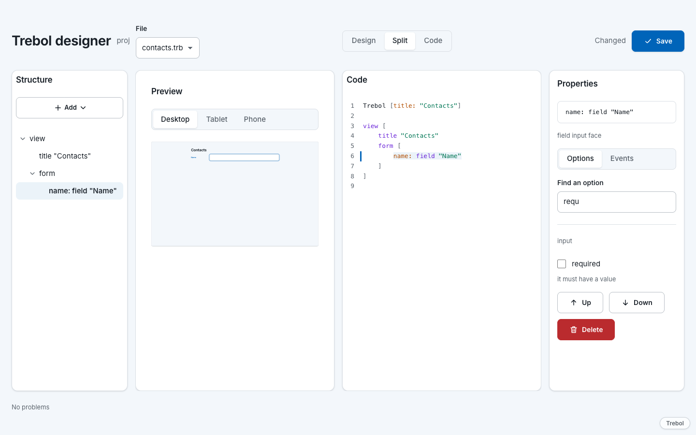
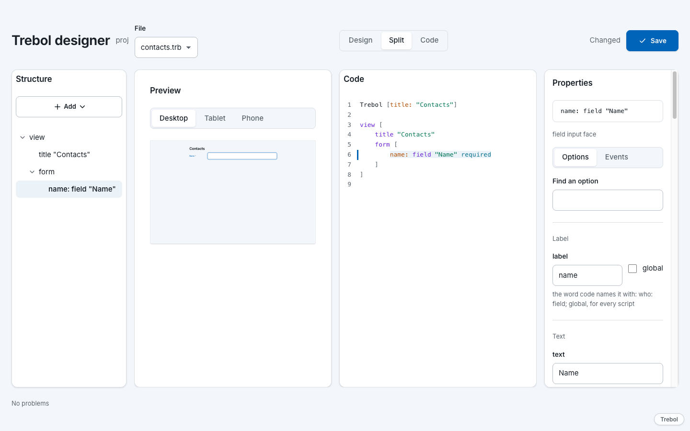
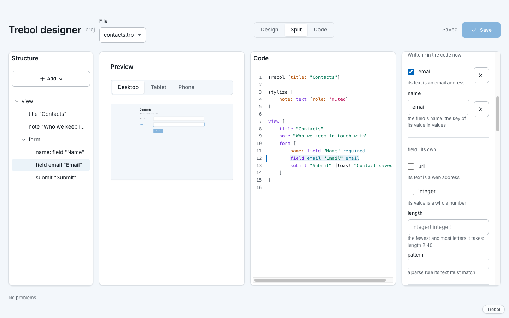

# 3. Properties

The properties panel shows everything about the chosen face, and each change you make there changes the code.

## The top of the panel

- The face as the structure names it, in a box: `name: field "Name"`.
- Below it, its **style** and the styles it builds on: `field input face` says this is a `field`, which is a
  kind of `input`, which is a kind of `face`. A face takes the options of all of them.
- **Options / Events**: what the panel shows. This chapter is about *Options*; [chapter 4](04-events.md) is
  about *Events*.
- **Find an option**: type part of an option's name or help to see only the options that match.

## Label

**label** is the word your code uses for the face. With `name` in it, the code reads `name: field "Name"`, and
any code in the file can read what was typed with `name/value`, or set it with `name/value: "Ann"`.

Tick **global** to make that word known to every script of the program, not just this file:
`global name: field "Name"`.

Empty the label to take it out.

The label is not the same as a field's **name** option, found among the options of `field`: the name is the key
of the field's value when the form gives all its values together (`values/email`), and is written after the
style: `field email "Email"`. A field may have both.

## Text

- **text** is what the face says: the words of a title, the label of a field, the caption of a button.
- **hint** is the grey text shown inside an empty field.

## Options

Below come the options the face's style takes, in a section for each style it builds on: first the style's own
(`field · its own`), then those of `input`, then those of every face. Each option has a line of help under it.
The control depends on what the option takes:

- **a box to tick**, for an option that is on or off, such as `required` or `email`;
- **joined buttons** or **a list**, for one word of a few, such as an alignment or a size;
- **a field to type in**, for values: a number, a text, a pair... Its grey hint says what it takes
  (`integer! integer!` is two whole numbers). When what you type is not what the option takes, it says so under
  the field, and the code is not changed until it is;
- **a small code box**, for an option that takes a block;
- **a field and a *Pick* button**, for an icon: type its name, `#star`, or pick one from the icons Trebol brings.

Some options are written in more than one way. A grid's columns, for one, take a number of equal columns, `3`,
or a weight for each, `[1 2 1]`, or `[small 1]` for a narrow side column: type any of them.

To find `required` quickly, type `requ` in **Find an option**:

Tick it: the code becomes `name: field "Name" required`, and the preview marks the field with a star.

## Written in the code now

The options a face has are listed first, under **Written · in the code now**, each with a **×** that takes it out
of the code. This is the place to look to see at a glance how a face differs from a plain one.

## Follows other faces

At the end of the panel, three small code boxes make a face follow others as they change:

- **is**: its value is what the block gives, worked out again each time a value the block reads changes;
- **calc**: the same, for a value nobody types in, such as a total;
- **react**: a block that runs again each time a value it reads changes.

For example, `calc [values/qty * values/price]` on a field shows the product of two others as they are typed.

## The view

Choosing **view** in the structure shows the words of the whole screen: its width, the space inside it and
between its faces, and the like. A view has no label nor text. Its events are those of the whole screen, such
as a key pressed anywhere.

Next: [events](04-events.md).
