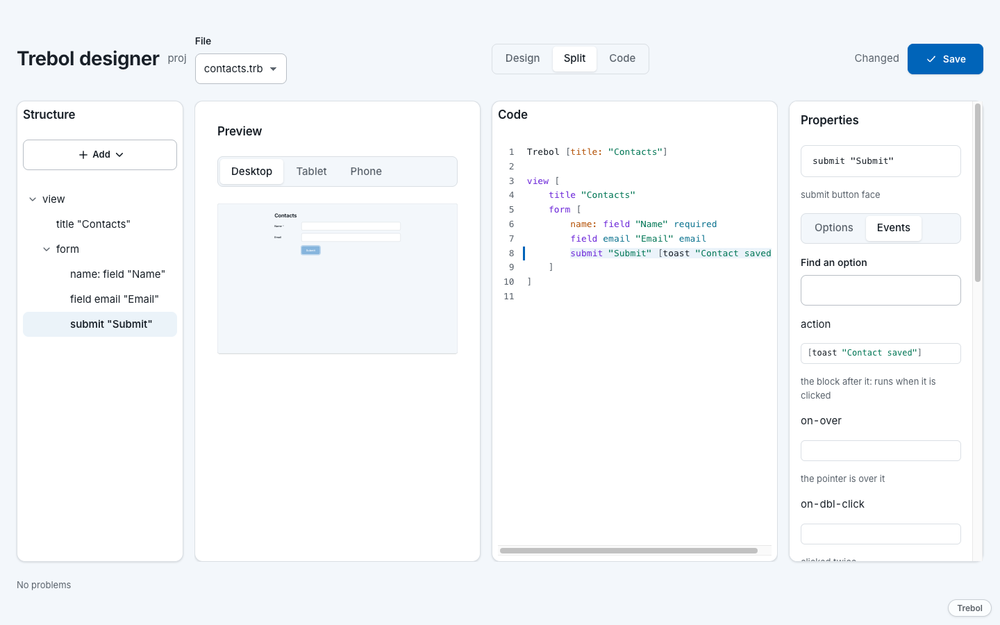

# 4. Events

Choose **Events** at the top of the properties to see what the chosen face can react to, each with a small
code box for the Trebol code that runs then.

## What a button does

Choose the **submit** of the form and choose **Events**. The first box, **action**, is the block written right
after the face: it runs when the face is clicked. Type in it:

```trebol
[toast "Contact saved"]
```

The code becomes `submit "Submit" [toast "Contact saved"]`. In the running program, clicking *Submit* now shows
a short message, *Contact saved*.



The preview does not run your code: it shows how the screen looks, not what it does. To try what a button does,
run the program itself (`npx trebol dev` in the project's folder).

## The other events

Below the action come the events the face's style fires, each with a line that says when: `on-change` (*its
value changed*), `on-focus` (*it took the focus*), `on-key` (*a key was pressed while it has the focus*),
`on-over` (*the pointer is over it*), and so on. Each face shows only the events its own style fires: a
field has `on-change`, a button has not.

Type a block in one to handle it, as `[toast "Changed"]` in `on-change`. The code gets
`on-change [toast "Changed"]` after the face. Events the face handles already are listed first, each with a
**×** that takes it out of the code. Empty a box to take its handler out too.

What a block may use depends on the event: in `on-change` the new value is `value`, in `on-select` of a table
the row chosen is `row`. The [UI tutorial](https://trebol-lang.com/docs/) and the reference of each style say
what each event gives.

**Find an option** narrows the events too: type `sel` to see only `on-select`.

## Events of the view and of a screen

The view's events are those of the whole window: `on-key` gets the keys no face takes, `on-find` what is asked
in the command palette (Ctrl+K). A screen of an app ([chapter 5](05-screens-tabs-rows.md)) adds `on-enter` and
`on-leave`, which run when the app goes to it and leaves it.

A tab or a step has no events of its own: its faces do.

Next: [screens, tabs, steps and rows](05-screens-tabs-rows.md).
