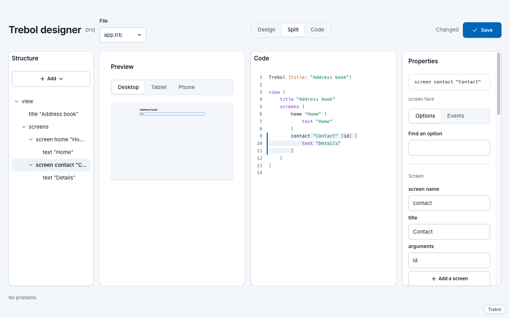
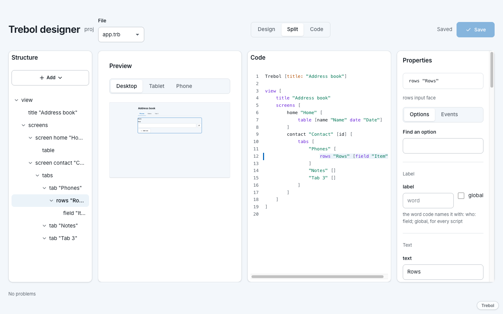

# 5. Screens, tabs, steps and rows

Most programs have more than one screen, and many screens hold more than fits at once. This chapter makes a
small address book in a new file of the project, `app.trb`:

```trebol
Trebol [title: "Address book"]

view [
    title "Address book"
]
```

Choose it in **File** at the top.

## The screens of an app

An app shows one screen at a time and goes from one to another: a list of contacts, then the contact chosen.

1. Choose **view** and click **Add**, **Layout**, **Screens of the app**. The designer adds `screens` with two
   screens to start with, *Home* and *Details*, each with a text in it.
2. Every screen is a row of the structure, `screen home "Home"`, with its faces under it. Choose
   `screen details "Details"`. Its properties have a section **Screen**:
   - **screen name**: the word the app goes to it by, `go 'details`. Type `contact`.
   - **title**: what the window is called while it shows. Type `Contact`.
   - **arguments**: what the screen is given when the app goes to it. Type `id`: the app goes to it with
     `go [contact 42]`, and the screen's code reads `id`.
   - **Add a screen** adds another, empty, after the last one.



The code reads:

```trebol
    screens [
        home "Home" [
            text "Home"
        ]
        contact "Contact" [id] [
            text "Details"
        ]
    ]
```

The preview shows one screen at a time: the one the chosen face is on, or the first when the chosen face is on
none. The first screen is the one the app starts on, so screens are not moved with *Up* and *Down*; *Delete*
takes one out.

Now fill them. Delete each `text`, then choose `screen home "Home"` and add **Data**, **Table**: the list of
contacts goes on the home screen.

## Tabs

The contact screen will show the contact's phones on one tab and notes on another.

1. Choose `screen contact "Contact"` and click **Add**, **Layout**, **Tabs**. Two tabs come in, *One* and
   *Two*, each a row of the structure.
2. Choose `tab "One"`. A tab has a single property, its **label**: type `Phones`. Choose `tab "Two"` and type
   `Notes`.
3. **Add a tab** adds a third after it.

Choosing a face inside a tab shows that tab in the preview, so you always see what you are working on.

A tab has no options nor events of its own; its faces do. *Delete* takes out the tab with its faces.

**Steps** work the same way: **Add**, **Layout**, **Steps** gives a wizard, one step after another with *Back*
and *Next*, and each step is a row with a **label**, and **Add a step**.

## Rows

A `rows` is a list the user fills in, one row at a time: the phones of a contact, the lines of an invoice. You
design one row, and the user adds as many as needed.

Choose `tab "Phones"` and click **Add**, **Input**, **Rows**. Under `rows "Rows"` in the structure is the row it
repeats, with one field. Choose the `rows` and add more faces: they go into that row. Each field of the row is
one column of what the user enters.



The code so far:

```trebol
view [
    title "Address book"
    screens [
        home "Home" [
            table [name "Name" date "Date"]
        ]
        contact "Contact" [id] [
            tabs [
                "Phones" [
                    rows "Rows" [field "Item"]
                ]
                "Notes" []
                "Tab 3" []
            ]
        ]
    ]
]
```

Next: [styles of your own](06-styles-of-your-own.md).
