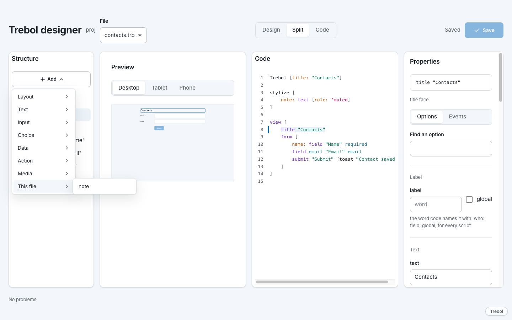

# 6. Styles of your own

When the same kind of face appears again and again (a muted note, a card with a title, a price shown always the
same way), a program gives it a name of its own with `stylize`. The designer reads those styles from the file
and offers them in the *Add* menu next to Trebol's own.

## A style in the file

Go back to `contacts.trb` and write this in the code, between the header and the view:

```trebol
stylize [
    note: text [role: 'muted]
]
```

`note` is now a style: a `text` in the muted colour. The code colours `note` as it colours Trebol's own styles.

## Adding it

Choose the title of the view and click **Add**. The menu has a new group at the end, **This file**, with every
style the file defines. Click **note**.



A `note` goes after the title. Choose it and type its **text**, `Who we keep in touch with`. Its properties are
those of the style it builds on: the panel shows `note text face`, and its options come in a section for each.

A style that holds other faces (one built on `panel`, `row`, `column`...) is added with an empty block, ready for
the faces you put inside it.

## Rules

A file may also add rules of its own to the dialect with `rule`: words that change any face they are written
after. The designer runs the file's rules as it runs its styles, so faces that use them lay out as they will in
the program. The options of a face list them under a section of their own, each a box to tick on or off.

Next: [the code](07-the-code.md).
