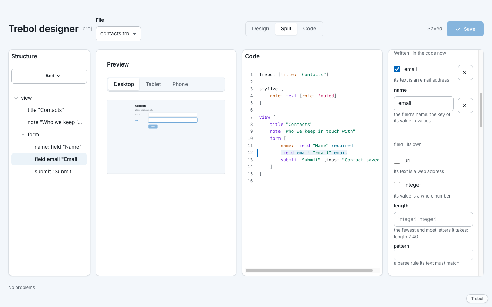
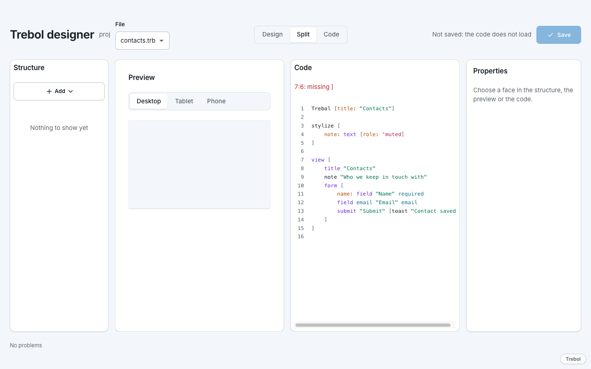
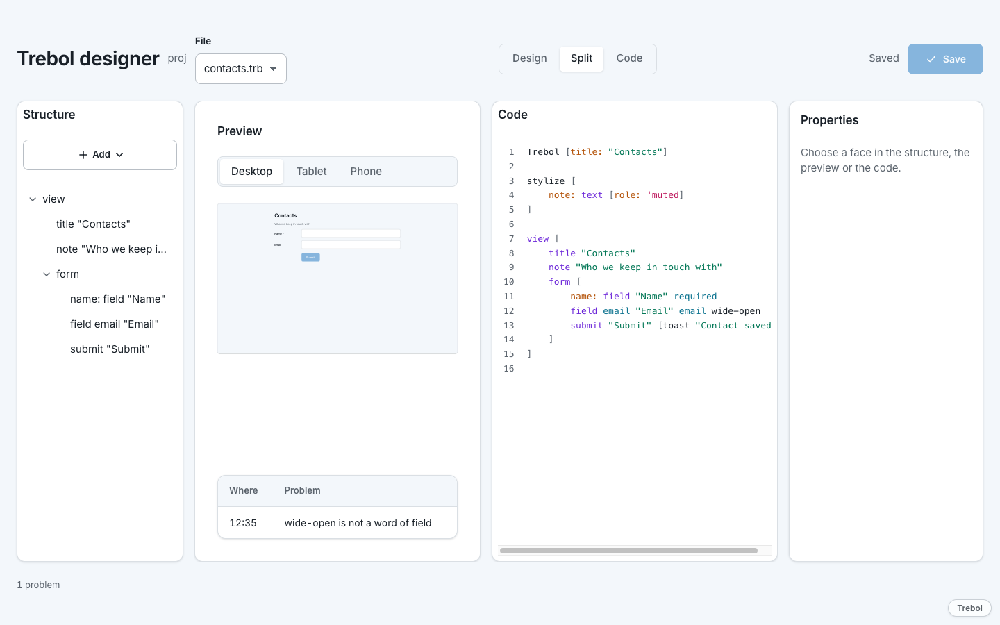

# 7. The code

The designer keeps no design of its own: the text of the file is the design. Whatever you do in the structure or
the properties rewrites the text, and whatever you write in the text changes the structure and the preview.
You can go from one to the other at any moment.

## What it changes, and what it keeps

A change rewrites only the text it is about. A new label replaces the old string and nothing else; a face added
takes a line of its own, indented as the faces beside it; a face that moves takes its comment with it; a face
that goes takes its line. Your comments, blank lines, spacing and order stay as you wrote them, and the rest of
the program, outside the views, is never touched.

## Writing by hand

Choose **Split** to see the code beside the preview, or **Code** to give it the whole middle. Type in it as in
any editor: the structure, the preview and the properties follow as you type.

Putting the cursor in a face chooses it: the innermost face written around the cursor, so with the cursor in a
field of a form, the field is chosen, not the form.

Some things are only written by hand. A value worked out by code when the program runs, such as a text made with
`compose` and parentheses, is kept as written, but has no control in the properties: change it in the code.

## Problems

Two kinds of problem can show up.

**The code does not load.** A bracket or a quote is missing, so the text is not Trebol yet. The top of the
window says *Not saved: the code does not load*, the code shows where and why in red (`7:6: missing ]`: line 7,
column 6), and *Save* is off until it loads again. While you type, the structure and the preview keep the last
design that loaded, so nothing jumps around under you.

**A face has a problem.** The code loads, but something in a view is wrong: an option a style does not take, an
icon Trebol does not know, a block where a text should be. A table under the preview lists each problem with the
line and column it is at, and the bottom of the window counts them. These are the same problems `trebol check`
finds; the file can be saved with them.

## Saving

**Save** writes the file to disk. *Changed* by it means there is something not saved yet. Choosing another file
in **File** while this one has changes asks whether to leave them; saying no stays on the file.

The designer has no *Undo* button yet: a change made with the mouse is taken back by changing it back, and a file
not saved is taken back by choosing another file and not keeping the changes. Saving often and keeping the
project in git is the safe way to work.

## On a web page

The designer also runs on a web page with no project behind it, as on trebol-lang.com. It then opens a sample
project, and *Save* downloads the file instead of writing it.
